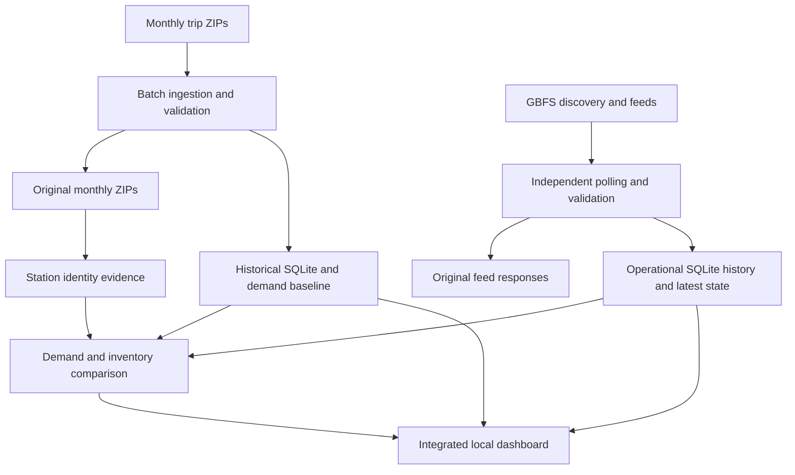

# Technical design

## Scope and architecture

Historical scope: JC-prefixed monthly Citi Bike files for Jersey City/Hoboken, August–September 2025. Historical charts and demand baseline use September 2025. Live scope selects GBFS station_information short_name starting JC/HB, so historical/live station coverage is not assumed identical. No ride sampling is used. This local stack avoids the cost of a broker/cloud service for a small polling workload.

Batch dependency: configured source files → download/raw retention → per-file ingest/transaction → manifest/validation → baseline and reports. Operational dependency: discovery → information + status fetch → join/validate → atomic batch/snapshot/poll commit → latest-state and change views → page read. The paths meet through a checked station crosswalk and weekday/hour baseline. Separate database read transactions are used; no cross-database atomic snapshot is claimed.

## Models and keys

| Object | Grain/key | Refresh |
|---|---|---|
| fact_trip | One accepted ride; ride_id primary key | Incremental per new source checksum |
| trip_arrival_time | One accepted ride's local arrival attributes; ride_id | With accepted ride |
| processed_files | One processed file checksum | Same transaction as file rows |
| rejected_records | File checksum, CSV name, source row and reason | Reject/conflict audit |
| Daily/hourly views | Date/hour/station grouping of accepted trips | SQL views |
| Monthly baseline view | Station × weekday × hour | Replace derived view for selected month |
| live_batches | One distinct pair of raw feed payloads; SHA256 batch_id | New payload pair |
| live_polls | One collection attempt; poll_id | Processed, repeated or failed |
| station_snapshots | One station per payload batch; (batch_id,station_id) | Append valid rows |
| live_quarantine | Batch/station/reason/raw record | Invalid joined record audit |
| station_latest | One retained latest station, ordered by report/feed time | Dynamic view with current freshness |
| station_inventory_changes | Snapshot with previous inventory and guarded delta | Dynamic SQL window view |

Raw history path: data/raw/YYYYMM/original.zip. Operational raw responses and discovery metadata: data/raw_live/. Monthly and comparison reports: data/reports/. Workflow logs/state: data/logs/, data/scheduler_state.json. The station dimensions are retained per live snapshot rather than a separate conformed dim_station; names/coordinates in raw history supply crosswalk evidence.

## Time and quality

Historical timestamps are assumed America/New_York, explicitly documented rather than proven by timestamp strings. Store UTC start/end and local date/hour/weekday; ambiguous or nonexistent DST times are rejected. Duration must be >0 and ≤24h. Missing station IDs are retained but excluded from that station's flow totals. Unexpected schema or corrupt ZIP aborts file processing; invalid individual records and conflicting ride IDs are quarantined. Duplicate equal ride IDs do not add trips; conflicts keep the first accepted ride. File SHA256 prevents reloading the same input. Calendar date boundaries can make file counts differ from local-month analysis counts.

GBFS normalized mapping: num_bikes_available→bikes_available; num_docks_available→docks_available; num_bikes_disabled/docks_disabled→unavailable counts; last_reported→source_reported_at; each feed's last_updated→feed timestamps; local fetch completion→observed_at. Information supplies name, short_name, coordinates and capacity. Raw field names and responses are preserved.

Missing/unmatched identifiers, negative counts, invalid flags/coordinates and future station reports beyond tolerance are rejected to live quarantine. Optional capacity/disabled counts stay NULL if absent. Duplicate IDs inside a batch abort/rollback that batch. Inventory sums inconsistent with reported capacity are retained with a warning, since transient updates and feed semantics can differ. Utilization is (available + disabled bikes)/capacity; unknown denominator/input or bike occupancy above capacity yields NULL. Installed/renting/returning flags gate operation and low inventory flags.

Normal stale threshold: 300 seconds for both station report and status feed, future tolerance 60 seconds. Missing in the latest valid batch or regressed source timestamps are unreliable. Successful fetches do not make old sources fresh. Latest known values stay visible with stale status. Low-bike/dock thresholds: ≤3. Current totals include only fresh, fully operational stations.

Net available-bike change is calculated only across source-progressing, nearby, operational and source-fresh snapshot pairs. It cannot identify departures or arrivals: rentals, returns, rebalancing and maintenance are unobserved between polls. Repeated payload pairs generate polling evidence without new snapshot rows. Status and information are fetched separately and can be temporarily inconsistent.

## Combined metric

Candidate join: historical station_id = GBFS short_name, not GBFS station_id. Require unique live short_name, a baseline, ≥5 valid raw coordinate observations, historical median location within 150m and matching dominant name after case/punctuation normalization. These are conservative exercise thresholds; station identity over time remains unproven. Export unmatched live reasons and all historical IDs without supported live matches. New/renamed/moved stations are not forced into a match.

Hourly demand = departures and arrivals divided by all calendar occurrences of that weekday, including zero days. Net outflow = mean departures − mean arrivals. Reference remaining-hour flow = net outflow × fraction until the end of that New York hour. Positive pressure triggers when reference outflow ≥ available bikes; negative pressure triggers when reference inflow magnitude ≥ available docks. Low inventory is a separate flag evaluated first. Stale, restricted, unmatched, warned or insufficient-sample records suppress pressure. One primary attention label is displayed; other inventory flags remain in the original station table. No-threshold-trigger does not mean safe.

September has only 4/5 weekday samples; station month-long eligibility and complete calendar coverage are assumptions. Uniform within-hour demand, old year/season, weather/holiday effects, unobserved rebalancing and variance limit interpretation. These are explainable indicators, not calibrated probabilities, guaranteed forecasts or precise stockout times. Recorded mode evaluates at the stored poll and never claims present availability.

## Orchestration, failures and recovery

workflow.json configures explicit months, analysis month, daily UTC time and retry policy. workflow.py uses the same installed interpreter, project working directory, a subprocess exit status and persistent logs. The scheduler checks every 30s; state is atomically replaced. OS locks are released when a process exits, including crashes. This is a foreground scheduler: reboot requires relaunch or a separately configured OS service; no service installation is claimed.

If an existing raw ZIP is corrupt, stop and preserve it under a different filename before downloading a fresh copy; normal download reuses existing files and does not silently repair them. During verification a truncated local raw copy correctly caused failure; a separately downloaded official copy restored a passing run. If downloads fail, `.part` is removed and retries occur. Rerun the batch; immutable raw files and committed manifests remain. A failed file transaction rolls back accepted/rejected/manifest rows together. Files already committed remain when a later file fails. If report export fails after ingestion, rerunning the complete batch rebuilds derived reports. Baseline replacement is transactional. Conflicts/rejects are not erased.

If a scheduled attempt fails or is interrupted, inspect data/logs and scheduler_state.json, then run workflow.py batch manually. A day's attempted job is not automatically repeated after restart; the next UTC date remains eligible. If live fetch/parse fails, existing inventory is retained, failures appear in live_polls, and future cycles continue. Initial discovery failure can exit before a polling log exists: terminal error is the evidence. Collector HTTP retries and TTL-aware polling are independent of batch retry. Stop collecting with Ctrl+C; committed rows remain. Restart respects the prior successful interval.

If the page cannot read the database, its error banner warns that retained display values may be old; current combined rows are cleared on read failure. Wrong paths do not create empty databases. Restart the dashboard after historical refresh. Close interfering database editors if Windows reports locks, and use one writer per database. Back up SQLite using its backup API or stop writers before copying; do not copy a live database blindly.

No automatic retention deletion is enabled: exercise defaults are bounded cycles. Long-running capture grows both raw and SQLite storage; archiving/retention is a documented future production requirement, not a implemented feature. The dashboard is bound to localhost and has no external-user authentication, high availability or production monitoring.
